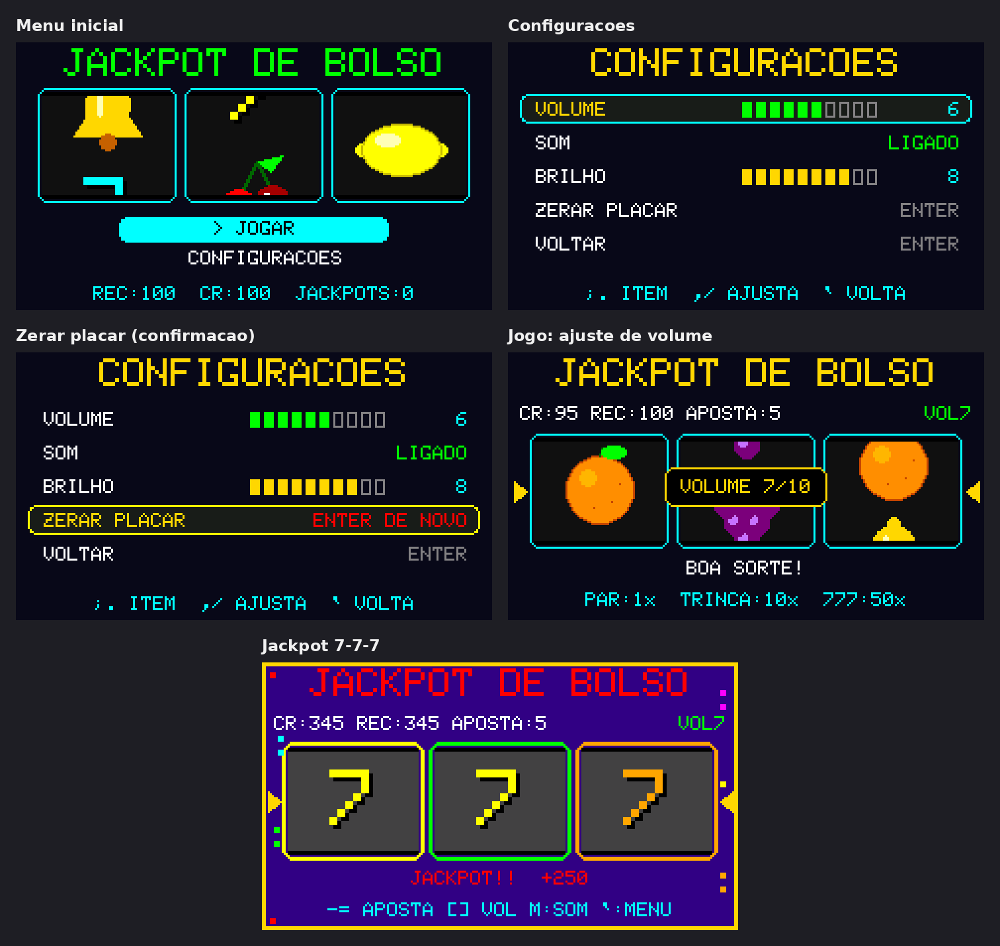

```
╔═════════════════════════════════════════════════════════════════╗
║                                                                 ║
║          ██╗ █████╗  ██████╗██╗  ██╗██████╗  ██████╗ ████████╗  ║
║          ██║██╔══██╗██╔════╝██║ ██╔╝██╔══██╗██╔═══██╗╚══██╔══╝  ║
║          ██║███████║██║     █████╔╝ ██████╔╝██║   ██║   ██║     ║
║     ██   ██║██╔══██║██║     ██╔═██╗ ██╔═══╝ ██║   ██║   ██║     ║
║     ╚█████╔╝██║  ██║╚██████╗██║  ██╗██║     ╚██████╔╝   ██║     ║
║      ╚════╝ ╚═╝  ╚═╝ ╚═════╝╚═╝  ╚═╝╚═╝      ╚═════╝    ╚═╝     ║
║                                                                 ║
║                 J A C K P O T   D E   B O L S O                 ║
║            a pocket-sized, pixel-powered slot machine           ║
║                                                                 ║
╚═════════════════════════════════════════════════════════════════╝
```

🌐 **English** · [Português (Brasil)](README.pt-BR.md)


> **Insert coin?** There is no coin slot. There is no money. There is only an ESP32-S3, three tiny reels, and an unreasonable amount of dopamine per square millimetre.

A complete jackpot / slot-machine game for the **M5Stack Cardputer**, written in Arduino C++.

It has spinning fruit, flashing lights, jackpot melodies, persistent high scores, a 4-second GAME OVER drama sequence, and a settings menu that speaks **Portuguese (PT-BR)** and **English**.

---

## 🎰 The Cabinet

| | |
|---|---|
| **Machine** | M5Stack Cardputer |
| **Display** | 240 × 135 px, 16-bit colour, sprite-rendered |
| **Brain** | ESP32-S3 |
| **Language** | Arduino C++ |
| **Sound** | Built-in speaker (microphone disabled — they share hardware) |
| **Memory** | NVS / flash via `Preferences` |
| **Frame rate** | ~50 FPS (20 ms frame budget) |
| **Reels** | 3 |
| **Symbols** | 🍒 cherry · 🍋 lemon · 🍊 orange · 🍇 grape · 🔔 bell · 7️⃣ seven |

---

## 🪙 Quick Start

1. Flash the sketch to your Cardputer.
2. The machine boots with **100 free credits**.
3. Press **any key** to spin.
4. Win, lose, or dramatically run out of credits.
5. The house always reloads you. Eventually.

No real currency is inserted, won, lost, or harmed in the making of this game.

---

## 🖥️ The Screens



*Real screenshots from the Cardputer: menu, settings, reset confirmation, volume toast, and the elusive 7-7-7 jackpot.*

The same screens in ASCII, for the terminal-inclined:

### Menu

```
+------------------------------------------+
|             JACKPOT DE BOLSO             |
|    +--------+  +--------+  +--------+    |
|    | CHERRY |  |  BELL  |  |   7    |    |
|    +--------+  +--------+  +--------+    |
|                 > JOGAR                  |
|              CONFIGURACOES               |
|       REC:100  CR:100  JACKPOTS:0        |
+------------------------------------------+
```

### Game

```
+------------------------------------------+
|             JACKPOT DE BOLSO             |
| CR:95 REC:120 APOSTA:5              VOL4 |
|    +--------+  +--------+  +--------+    |
|    | CHERRY |  | CHERRY |  |  BELL  |    |
|    +--------+  +--------+  +--------+    |
|                 PAR!  +5                 |
|       PAR:1x  TRINCA:10x  777:50x        |
+------------------------------------------+
```

### GAME OVER

```
+------------------------------------------+
|                                          |
|                GAME OVER                 |
|               SEM CREDITOS               |
|           RECARREGANDO EM 3...           |
| ######################------------------ |
|        NOVA RECARGA: 100 CREDITOS        |
|                                          |
+------------------------------------------+
```

When the balance hits zero, the machine holds the **GAME OVER** screen for **4 seconds**, shows a refill countdown and progress bar, then drops you back into the game with **100 credits**.

### Settings

```
+------------------------------------------+
|              CONFIGURACOES               |
|  > VOLUME        #######---            7 |
|    SOM                            LIGADO |
|    BRILHO        #######---            7 |
|    IDIOMA                          PT-BR |
|    ZERAR PLACAR                    ENTER |
|    VOLTAR                          ENTER |
|       ;. ITEM  ,/ AJUSTA  ` VOLTA        |
+------------------------------------------+
```

---

## 💰 Payout Table

Multipliers are applied to the current bet and **include the returned stake**.

| Combination | Multiplier | On a 5-credit bet | House voice |
|---|---:|---:|---|
| Any pair | **1×** | 5 credits | “Your bet tiptoes back home.” |
| Triple (not 7s) | **10×** | 50 credits | “The machine buys dinner.” |
| **7 · 7 · 7** | **50×** | 250 credits | “The machine buys the restaurant.” |

> A pair is technically a break-even. The flashing lights are there to soften the truth.

Bet options: **1, 2, 5, 10, 25** credits (default **5**).

If your balance is smaller than the current bet, the machine automatically lowers the bet to something you can afford. If you can afford nothing, it reaches for the GAME OVER lever.

---

## 🎹 Controls

### Menu

| Key | Action |
|---|---|
| `;` / `.` | Move selection |
| `ENTER` / `SPACE` | Open |
| `1` | Jump to **PLAY** |
| `2` | Jump to **SETTINGS** |

### Settings

| Key | Action |
|---|---|
| `;` / `.` | Choose item |
| `,` / `/` | Adjust value |
| `-` / `+` | Adjust value |
| `ENTER` / `SPACE` | Toggle / confirm |
| `` ` `` | Back to menu |

Reset score requires **two ENTER presses within 3 seconds**. Yes, it is a tiny safety interlock. No, it will not save you from yourself.

### Game

| Key | Action |
|---|---|
| any key | **SPIN** |
| `-` / `_` | Lower bet |
| `=` / `+` | Raise bet |
| `[` / `,` | Volume down |
| `]` / `/` | Volume up |
| `m` / `M` | Mute / unmute |
| `` ` `` | Back to menu |
| any key during celebration | Skip the celebration |

During **GAME OVER**, keys are ignored except volume and mute. The machine is having a moment.

---

## ⚙️ Settings That Stick

| Setting | Range | Default |
|---|---|---:|
| Volume | 0 – 10 | 4 |
| Sound | on / off | on |
| Brightness | 1 – 10 | 7 |
| Language | PT-BR / English | PT-BR |
| Bet | 1 / 2 / 5 / 10 / 25 | 5 |

The language setting translates the entire UI: menu, settings, game HUD, payout table, stats, toasts, and the GAME OVER screen.

---

## 🧠 The House Remembers

Everything important lives in NVS and survives power loss:

```text
credits · best · spins · wins · jackpots · bet
volume · brightness · muted · language
```

That means your high score, your jackpot count, your language preference, and your shame are all persistent.

---

## 🔧 Build It

### Arduino IDE

1. Install **Arduino IDE 2.x**.
2. Add the **M5Stack board package** via Boards Manager.
3. Install the libraries via Library Manager:
   - `M5Cardputer`
   - `M5Unified`
   - `M5GFX`
4. Open `CardputerJackpot.ino`.
5. Select **M5Cardputer** as the board and the correct serial port.
6. Upload.

### arduino-cli (optional)

```bash
arduino-cli core install m5stack:esp32 \
  --additional-urls https://static-cdn.m5stack.com/resource/arduino/package_m5stack_index.json

arduino-cli lib install M5Cardputer

arduino-cli board listall cardputer   # confirm the exact FQBN
arduino-cli compile --fqbn m5stack:esp32:m5stack_cardputer CardputerJackpot
arduino-cli upload -p /dev/ttyACM0 --fqbn m5stack:esp32:m5stack_cardputer CardputerJackpot
```

> The microphone is explicitly stopped in `setup()` because it shares hardware with the speaker. This is not a bug; it is a peace treaty.

---

## 🧩 Under the Hood

| Part | What it does |
|---|---|
| `setup()` | Boots M5, loads NVS, applies settings, allocates sprites |
| `loop()` | Reads keys, updates game state, plays audio, renders at ~50 FPS |
| `startSpin()` | Debits the bet, builds reel strips, starts staggered spins |
| `evaluateSpin()` | Checks pairs / triples / 777, pays out, saves stats |
| `updateGame()` | Runs reel easing, celebrations, and the GAME OVER timer |
| `drawGame()` | HUD, reels, win highlighting, rotating info line, confetti |
| `drawGameOver()` | Countdown, progress bar, refill announcement |
| `drawSettings()` | Volume, sound, brightness, language, reset, back |
| `drawReel()` | Draws the scrolling cylinder into a 66 × 54 sprite |
| `tr()` | Looks up UI strings in the active language table |

### Timing cheat sheet

| Event | Duration |
|---|---:|
| Frame | 20 ms |
| Reel stop times | ~1.7 s / ~2.35 s / ~3.0 s |
| Celebration | 2.3 s |
| GAME OVER | 4.0 s |
| Info line rotation | 3.0 s |
| Toast | 1.5 s |
| Reset confirmation window | 3.0 s |

### Is the machine fair?

Each reel's final symbol is chosen independently with `random(0, SYMBOL_COUNT)` after seeding with `esp_random()`. The long symbol sequence is only animation theatre. The reels are honest; the presentation is showbiz.

---

## 🛠️ Troubleshooting

| Symptom | Likely cause | Fix |
|---|---|---|
| “Falha ao alocar sprites” / “Sprite allocation failed” | Not enough RAM at boot | Restart the Cardputer |
| No sound | Muted, or volume is 0 | Press `m`, raise volume with `]` |
| Keys do nothing during GAME OVER | Working as intended | Wait 4 seconds |
| Credits suddenly became 100 | You hit zero | The house refilled you |
| UI is in the wrong language | Language setting | Settings → IDIOMA / LANGUAGE |
| Reels look like they cheat | They do not | It just feels like it |

---

## 🗺️ Wishlist / Future Jackpots

- [ ] More paylines than “the middle one”
- [ ] Bonus round with suspiciously generous fruit
- [ ] Animated high-score celebration
- [ ] Custom reel symbol sets
- [ ] A coin slot that is just a drawing of a coin slot

---

## ⚠️ House Disclaimer

This is a **toy**. Credits are fictional, have no monetary value, and cannot be exchanged for anything except the fleeting satisfaction of watching a pixelated bell flash.

No real gambling. No real money. No real jackpot. Just a very small casino that fits in your pocket and runs on electricity and optimism.

---

## 📜 License

This project is released into the public domain under **The Unlicense**. Copy it, modify it, sell it, or turn it into a real slot machine — no conditions, no attribution required. See [LICENSE](LICENSE).

---

```
        ╔══════════════════════════════════════════════════════════╗
        ║                                                          ║
        ║              T H A N K   Y O U   F O R                   ║
        ║                   P L A Y I N G                          ║
        ║                                                          ║
        ║          GAME OVER?  +100 CREDITS, ALWAYS.               ║
        ║                                                          ║
        ╚══════════════════════════════════════════════════════════╝
```

🌐 [Leia em Português (Brasil)](README.pt-BR.md)
