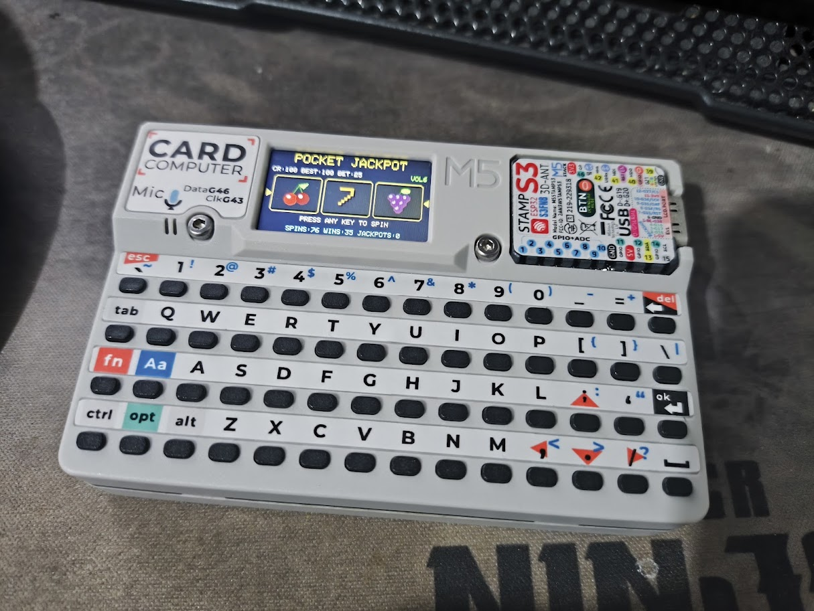

```
╔═════════════════════════════════════════════════════════════════╗
║                                                                 ║
║          ██╗ █████╗  ██████╗██╗  ██╗██████╗  ██████╗ ████████╗  ║
║          ██║██╔══██╗██╔════╝██║ ██╔╝██╔══██╗██╔═══██╗╚══██╔══╝  ║
║          ██║███████║██║     █████╔╝ ██████╔╝██║   ██║   ██║     ║
║     ██   ██║██╔══██║██║     ██╔═██╗ ██╔═══╝ ██║   ██║   ██║     ║
║     ╚█████╔╝██║  ██║╚██████╗██║  ██╗██║     ╚██████╔╝   ██║     ║
║      ╚════╝ ╚═╝  ╚═╝ ╚═════╝╚═╝  ╚═╝╚═╝      ╚═════╝    ╚═╝     ║
║                                                                 ║
║                 J A C K P O T   D E   B O L S O                 ║
║            um caça-níqueis de bolso movido a pixels             ║
║                                                                 ║
╚═════════════════════════════════════════════════════════════════╝
```

🌐 [English](README.md) · **Português (Brasil)**


> **Inserir moeda?** Não há slot para moedas. Não há dinheiro. Há apenas um STAMP S3, três rolos minúsculos e uma quantidade absurda de dopamina por milímetro quadrado.

Um jogo completo de jackpot / caça-níqueis para o **M5Stack Card Computer**, escrito em Arduino C++.

Tem frutas girando, luzes piscando, melodias de jackpot, recordes persistentes, uma sequência dramática de **GAME OVER** de 4 segundos e um menu de configurações que fala **português (PT-BR)** e **inglês**.

---

## 🎰 A Máquina

| | |
|---|---|
| **Máquina** | M5Stack Card Computer |
| **Tela** | 240 × 135 px, 16 bits, renderizada com sprites |
| **Cérebro** | STAMP S3 |
| **Linguagem** | Arduino C++ |
| **Som** | Alto-falante embutido (microfone desativado — compartilham o hardware) |
| **Memória** | NVS / flash via `Preferences` |
| **Taxa de quadros** | ~50 FPS (orçamento de 20 ms por quadro) |
| **Rolos** | 3 |
| **Símbolos** | 🍒 cereja · 🍋 limão · 🍊 laranja · 🍇 uva · 🔔 sino · 7️⃣ sete |



*A máquina de verdade: um M5 Card Computer rodando o jogo (interface em inglês).*

---

## 🪙 Início Rápido

1. Grave o sketch no seu Card Computer.
2. A máquina inicia com **100 créditos grátis**.
3. Pressione **qualquer tecla** para girar.
4. Ganhe, perca ou fique dramaticamente sem créditos.
5. A casa sempre recarrega você. Eventualmente.

Nenhuma moeda real é inserida, ganha, perdida ou maltratada na produção deste jogo.

---

## 🖥️ As Telas


*Capturas reais do Card Computer: menu, configurações, confirmação de zerar placar, aviso de volume e o raro jackpot 7-7-7.*

As mesmas telas em ASCII, para os aficionados por terminal:

### Menu

```
+------------------------------------------+
|             JACKPOT DE BOLSO             |
|    +--------+  +--------+  +--------+    |
|    | CEREJA |  |  SINO  |  |   7    |    |
|    +--------+  +--------+  +--------+    |
|                 > JOGAR                  |
|              CONFIGURACOES               |
|       REC:100  CR:100  JACKPOTS:0        |
+------------------------------------------+
```

### Jogo

```
+------------------------------------------+
|             JACKPOT DE BOLSO             |
| CR:95 REC:120 APOSTA:5              VOL4 |
|    +--------+  +--------+  +--------+    |
|    | CEREJA |  | CEREJA |  |  SINO  |    |
|    +--------+  +--------+  +--------+    |
|                 PAR!  +5                 |
|       PAR:1x  TRINCA:10x  777:50x        |
+------------------------------------------+
```

### GAME OVER

```
+------------------------------------------+
|                                          |
|                GAME OVER                 |
|               SEM CREDITOS               |
|           RECARREGANDO EM 3...           |
| ######################------------------ |
|        NOVA RECARGA: 100 CREDITOS        |
|                                          |
+------------------------------------------+
```

Quando o saldo chega a zero, a máquina mantém a tela **GAME OVER** por **4 segundos**, mostra uma contagem regressiva e uma barra de progresso e então volta ao jogo com **100 créditos**.

### Configurações

```
+------------------------------------------+
|              CONFIGURACOES               |
|  > VOLUME        #######---            7 |
|    SOM                            LIGADO |
|    BRILHO        #######---            7 |
|    IDIOMA                          PT-BR |
|    ZERAR PLACAR                    ENTER |
|    VOLTAR                          ENTER |
|       ;. ITEM  ,/ AJUSTA  ` VOLTA        |
+------------------------------------------+
```

---

## 💰 Tabela de Pagamentos

Os multiplicadores são aplicados à aposta atual e **incluem a aposta devolvida**.

| Combinação | Multiplicador | Com aposta de 5 créditos | Voz da casa |
|---|---:|---:|---|
| Qualquer par | **1×** | 5 créditos | “Sua aposta volta para casa na ponta dos pés.” |
| Trinca (exceto 7s) | **10×** | 50 créditos | “A máquina paga o jantar.” |
| **7 · 7 · 7** | **50×** | 250 créditos | “A máquina compra o restaurante.” |

> Um par é tecnicamente um empate. As luzes piscando estão aí para suavizar a verdade.

Opções de aposta: **1, 2, 5, 10, 25** créditos (padrão **5**).

Se seu saldo for menor que a aposta atual, a máquina reduz automaticamente a aposta para algo que você possa pagar. Se você não puder pagar nada, ela puxa a alavanca do GAME OVER.

---

## 🎹 Controles

### Menu

| Tecla | Ação |
|---|---|
| `;` / `.` | Move a seleção |
| `ENTER` / `ESPAÇO` | Abre |
| `1` | Vai para **JOGAR** |
| `2` | Vai para **CONFIGURAÇÕES** |

### Configurações

| Tecla | Ação |
|---|---|
| `;` / `.` | Escolhe o item |
| `,` / `/` | Ajusta o valor |
| `-` / `+` | Ajusta o valor |
| `ENTER` / `ESPAÇO` | Alterna / confirma |
| `` ` `` | Volta ao menu |

Zerar o placar exige **dois ENTER em até 3 segundos**. Sim, é um pequeno trava de segurança. Não, não vai salvar você de você mesmo.

### Jogo

| Tecla | Ação |
|---|---|
| qualquer tecla | **GIRA** |
| `-` / `_` | Diminui a aposta |
| `=` / `+` | Aumenta a aposta |
| `[` / `,` | Diminui o volume |
| `]` / `/` | Aumenta o volume |
| `m` / `M` | Liga/desliga o som |
| `` ` `` | Volta ao menu |
| qualquer tecla durante a comemoração | Encerra a comemoração |

Durante o **GAME OVER**, as teclas são ignoradas, exceto volume e mudo. A máquina está tendo um momento.

---

## ⚙️ Configurações Que Ficam

| Configuração | Faixa | Padrão |
|---|---|---:|
| Volume | 0 – 10 | 4 |
| Som | ligado / desligado | ligado |
| Brilho | 1 – 10 | 7 |
| Idioma | PT-BR / Inglês | PT-BR |
| Aposta | 1 / 2 / 5 / 10 / 25 | 5 |

A opção de idioma traduz toda a interface: menu, configurações, HUD do jogo, tabela de pagamentos, estatísticas, avisos e a tela de GAME OVER.

---

## 🧠 A Casa Lembra

Tudo o que importa fica na NVS e sobrevive à falta de energia:

```text
créditos · recorde · giros · vitórias · jackpots · aposta
volume · brilho · mudo · idioma
```

Ou seja, seu recorde, sua contagem de jackpots, sua preferência de idioma e sua vergonha são todos persistentes.

---

## 🔧 Como Compilar

### Arduino IDE

1. Instale o **Arduino IDE 2.x**.
2. Adicione o **pacote de placas M5Stack** pelo Gerenciador de Placas.
3. Instale as bibliotecas pelo Gerenciador de Bibliotecas:
   - `M5Cardputer`
   - `M5Unified`
   - `M5GFX`
4. Abra `CardputerJackpot.ino`.
5. Selecione **M5Cardputer** como placa e a porta serial correta.
6. Envie o código.

### arduino-cli (opcional)

```bash
arduino-cli core install m5stack:esp32 \
  --additional-urls https://static-cdn.m5stack.com/resource/arduino/package_m5stack_index.json

arduino-cli lib install M5Cardputer

arduino-cli board listall cardputer   # confirme o FQBN exato
arduino-cli compile --fqbn m5stack:esp32:m5stack_cardputer CardputerJackpot
arduino-cli upload -p /dev/ttyACM0 --fqbn m5stack:esp32:m5stack_cardputer CardputerJackpot
```

> O microfone é desligado explicitamente em `setup()` porque compartilha o hardware com o alto-falante. Isso não é um bug; é um tratado de paz.

---

## 🧩 Por Dentro

| Parte | O que faz |
|---|---|
| `setup()` | Inicializa o M5, carrega a NVS, aplica as configurações, aloca os sprites |
| `loop()` | Lê as teclas, atualiza o estado do jogo, toca o áudio, renderiza a ~50 FPS |
| `startSpin()` | Debita a aposta, monta as sequências dos rolos, inicia os giros escalonados |
| `evaluateSpin()` | Verifica pares / trincas / 777, paga, salva as estatísticas |
| `updateGame()` | Executa a animação dos rolos, as comemorações e o temporizador do GAME OVER |
| `drawGame()` | HUD, rolos, destaque de vitória, linha de informações rotativa, confete |
| `drawGameOver()` | Contagem regressiva, barra de progresso, anúncio da recarga |
| `drawSettings()` | Volume, som, brilho, idioma, zerar placar, voltar |
| `drawReel()` | Desenha o cilindro rolante em um sprite de 66 × 54 |
| `tr()` | Busca os textos da interface na tabela do idioma ativo |

### Guia de Tempos

| Evento | Duração |
|---|---:|
| Quadro | 20 ms |
| Parada dos rolos | ~1,7 s / ~2,35 s / ~3,0 s |
| Comemoração | 2,3 s |
| GAME OVER | 4,0 s |
| Rotação da linha de informações | 3,0 s |
| Aviso | 1,5 s |
| Janela de confirmação do reset | 3,0 s |

### A Máquina É Justa?

O símbolo final de cada rolo é escolhido independentemente com `random(0, SYMBOL_COUNT)` após a semente com `esp_random()`. A longa sequência de símbolos é apenas teatro de animação. Os rolos são honestos; a apresentação é show business.

---

## 🛠️ Solução de Problemas

| Sintoma | Causa provável | Solução |
|---|---|---|
| “Falha ao alocar sprites” / “Sprite allocation failed” | RAM insuficiente na inicialização | Reinicie o Card Computer |
| Sem som | Mudo ou volume em 0 | Pressione `m`, aumente o volume com `]` |
| As teclas não fazem nada durante o GAME OVER | Funcionando como esperado | Aguarde 4 segundos |
| Os créditos de repente viraram 100 | Você chegou a zero | A casa recarregou você |
| A interface está no idioma errado | Configuração de idioma | Configurações → IDIOMA / LANGUAGE |
| Os rolos parecem trapacear | Eles não trapaceiam | É só impressão |

---

## 🗺️ Lista de Desejos / Próximos Jackpots

- [ ] Modo multiplayer usando a conectividade do STAMP S3
- [ ] Mais linhas de pagamento do que “a do meio”
- [ ] Rodada bônus com frutas suspeitosamente generosas
- [ ] Comemoração animada de recorde
- [ ] Conjuntos personalizados de símbolos dos rolos
- [ ] Um slot de moedas que é só o desenho de um slot de moedas

---

## ⚠️ Aviso da Casa

Isto é um **brinquedo**. Os créditos são fictícios, não têm valor monetário e não podem ser trocados por nada, exceto pela satisfação passageira de ver um sino pixelado piscar.

Sem apostas reais. Sem dinheiro real. Sem jackpot real. Apenas um cassino muito pequeno que cabe no seu bolso e funciona com eletricidade e otimismo.

---

## 📜 Licença

Este projeto é liberado para o domínio público sob a **The Unlicense**. Copie, modifique, venda ou transforme em um caça-níqueis de verdade — sem condições e sem exigência de atribuição. Veja [LICENSE](LICENSE).

---

```
        ╔══════════════════════════════════════════════════════════╗
        ║                                                          ║
        ║                 O B R I G A D O   P O R                  ║
        ║                        J O G A R                         ║
        ║                                                          ║
        ║            GAME OVER?  +100 CRÉDITOS, SEMPRE.            ║
        ║                                                          ║
        ╚══════════════════════════════════════════════════════════╝
```

🌐 [Read in English](README.md)
